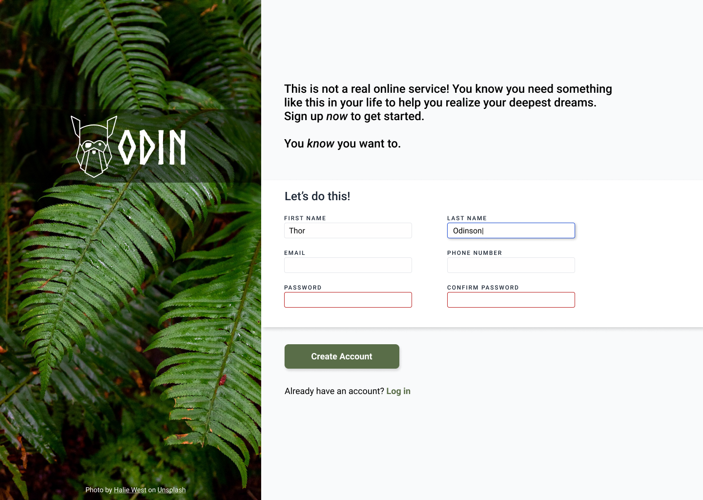

# Form

This was created to complete a project in [The Odin Project](https://www.theodinproject.com/lessons/node-path-intermediate-html-and-css-sign-up-form) using just html, css, and js.

These kinds of projects provide an image which we base our webpage on. This project helped me practice the standard form structure and basic form styling. No AI was used in the creation process, [MDN](https://developer.mozilla.org/) was the primary reference resource.

# This was the provided reference image:-

